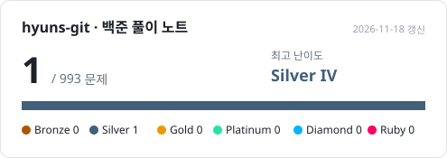

# 백준 풀이 노트

[tony9402/baekjoon](https://github.com/tony9402/baekjoon) 코딩테스트 문제집을 카테고리별로 풀고, 문제마다 코드와 풀이 방법·이유·복잡도를 정리한 저장소입니다.
난이도 표기는 solved.ac 기준입니다. 이 README와 통계 카드는 풀이를 커밋할 때 자동으로 갱신됩니다.

## 카테고리별 진행

| 카테고리 | 푼 문제 | 전체 | 진행률 |
|:--|--:|--:|--:|
| 자료구조 | 1 | 25 | 4% |
| 자료구조 2 | 0 | 21 | 0% |
| 트리 | 0 | 44 | 0% |
| 수학 | 0 | 29 | 0% |
| 탐욕법 | 0 | 62 | 0% |
| 동적계획법 1 | 0 | 80 | 0% |
| 동적계획법 2 | 0 | 81 | 0% |
| 투 포인터 | 0 | 36 | 0% |
| 구현 | 0 | 51 | 0% |
| 그래프 탐색 | 0 | 96 | 0% |
| 완전탐색 | 0 | 94 | 0% |
| 시뮬레이션 | 0 | 48 | 0% |
| 이분탐색 | 0 | 66 | 0% |
| 백트래킹 | 0 | 75 | 0% |
| 분할정복 | 0 | 18 | 0% |
| 누적 합 | 0 | 32 | 0% |
| 문자열 | 0 | 63 | 0% |
| 최단거리 | 0 | 53 | 0% |
| 위상정렬 | 0 | 14 | 0% |
| 분리 집합 | 0 | 20 | 0% |
| 최소 스패닝 트리 | 0 | 24 | 0% |
| 트라이 | 0 | 9 | 0% |
| 트리디피 | 0 | 8 | 0% |

## 푼 문제

### 자료구조

| 번호 | 제목 | 난이도 | 언어 | 풀이 |
|:--:|:--|:--|:--|:--:|
| [10828](https://www.acmicpc.net/problem/10828) | 스택 | Silver IV | C++ | [보기](./data_structure/10828) |
